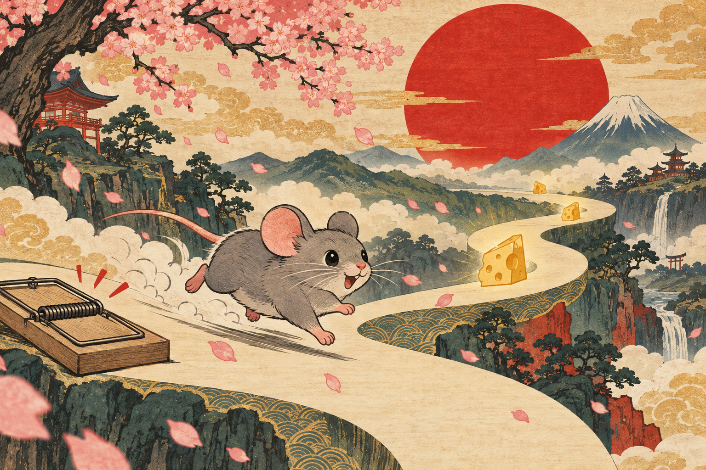

# RATÓN (ラトン) — el juego del queso



Un **endless runner vertical de 3 carriles** pensado para el móvil: perfecto para
el tren, el café o la sala de espera. Eres un ratoncito japonés muy decidido:
esquiva **trampas de ratón**, come **queso** y acumula **AURA** dorada rozando el
peligro. Estética de arte japonés moderno: papel washi, tinta, bermellón y pétalos
de sakura.

---

## Cómo se juega

| Acción | Efecto |
| --- | --- |
| **Deslizar ← / →** (o tocar mitad izq/der, o flechas del teclado) | Cambiar de carril |
| **Queso** | **+100 m** de distancia. Quesos seguidos = **combo** (×2, ×3…) |
| **Trampa de ratón** | Pierdes una vida; la partida termina al llegar a 0 |
| **Rozar una trampa** (near-miss) | **+1 AURA**: multiplica la velocidad a la que ganas metros y envuelve al ratón en llamas doradas |
| **Cada 500 m** | Celebración con pétalos y acorde de koto |

### Opciones (menú ⚙ o en pausa)

- **Efectos**: volumen 0–100 y silencio. Afecta solo al canal de efectos
  (queso, trampas, aura, jingles) — la música sigue sonando.
- **Música de fondo**: interruptor + volumen propio. Es un secuenciador *live*
  sobre escala **Miyako-bushi** (koto de 3 parciales, bajo, drone y taiko) que
  **suena en el menú (modo calma) y en la partida (sube de tempo y densidad con
  tu velocidad)**. Arranca con tu primer toque (política de autoplay del
  navegador). **En segundo/tercer plano se corta de inmediato**: al ocultar la
  pestaña se suspende el contexto de audio (ni música ni efectos suenan fuera),
  y al volver se reanuda solo.
- **Controles táctiles**, elegidos a tu gusto:
  - **Deslizar** — **solo deslizamiento**: 1 gesto = 1 carril. Ni saltos dobles
    ni respuesta al toque (eso es de Zonas).
  - **Zonas** — toca la mitad izquierda o derecha.
  - **Giroscopio** — inclina el celular: 1 inclinación = 1 carril, con
    calibración de tu postura y zona muerta anti-temblor. **Antes de activarse
    se comprueba el sensor de verdad** (`src/game/tilt.ts`): si Safari no tiene
    permiso aparece el botón «Activar giroscopio» con instrucciones para
    arreglarlo (Ajustes → Safari → Movimiento y acceso al sensor), y si el
    dispositivo no tiene sensor te ofrece cambiar de control con un toque.
    Requiere HTTPS (GitHub Pages lo es).
- **Vibrar**: activa/desactiva la vibración háptica.

Todo se guarda automáticamente en el dispositivo.

### Vidas y power-ups (modo 3 Carriles)

- **Band-Aid (🩹)**: son tus vidas. Empiezas con **3** (máx **9**). Tocar una
  trampa quita una; con 0 vidas se acaba la partida. Las curitas tienen un
  **50 % de probabilidad por oportunidad de power-up**, con al menos **18 s
  de juego entre apariciones**. No aparecen durante los primeros 18 s ni
  cuando ya tienes 9 vidas. Las oportunidades siguen separadas por 3800-7000 px.
- **Fresa (🍓)**: muy rara y **no acumulable**; activa un **×20** a la distancia
  por queso durante **10 segundos** (indicador 🍓 ×20s en pantalla).
  Volver a cogerla reinicia los 10 s, nunca los suma.

### Modo Fila de Ratones — Snake (`行列`)

Accesible directo desde el menú principal (botón **FILA DE RATONES**):
- **Escenario cuadrado** (`11×11`) con estética de tatami y marco de madera.
- Cada **queso** que comes suma **1 ratoncito bebé** a tu fila que te sigue en
  las **4 direcciones** (`↑ ↓ ← →`, con Deslizar, cruceta de Zonas, Giroscopio
  o teclado).
- **Las paredes son portales**: si sales por la derecha apareces por la
  izquierda a la misma altura (igual arriba ↔ abajo). Nunca hacen daño, y la
  fila cruza con una transición continua (el borde bermellón discontinuo lo
  indica). Las trampas y el queso se generan contando esos atajos.
- Chocar contra **tu propia fila** o una **trampa** te hace perder la
  **mitad de los ratoncitos**. Si te quedas con 0 en la cola y sin escudos y
  recibes un golpe, termina la partida.
- **Curitas (🩹)**: otorgan **escudos** contra pérdidas (hasta un máximo de
  **3**). Si chocas teniendo un escudo, consumes uno y conservas toda tu fila.
- Tu mejor fila (`snakeBest`) se guarda por separado en IndexedDB.

Tu **mejor distancia se guarda automáticamente** en el dispositivo con
**IndexedDB** (con espejo en localStorage), junto con partidas jugadas, quesos
totales y aura máxima.

## Stack

- **React 19 + Vite 7 + TypeScript**
- **Tailwind CSS 4**
- **Canvas 2D** — todo el arte es procedural (sin sprites), estilo ukiyo-e moderno
- **Web Audio API** — sonido 100 % procedural con escala pentatónica japonesa
- **Framer Motion** — menús y el sello hanko de nuevo récord
- **IndexedDB** — persistencia del récord
- **gh-pages** — despliegue a GitHub Pages

## Inicio rápido (desarrollo)

```bash
npm install
npm run dev
```

Abre la URL local y, para probarlo como en el móvil, usa las herramientas de
desarrollo del navegador en modo dispositivo (o sírvete la IP local desde tu
teléfono).

## Despliegue en GitHub Pages (repo "Raton")

### Paso 0 — una sola vez por máquina

Necesitas [Node.js](https://nodejs.org) y [Git](https://git-scm.com) instalados y
tu identidad de git configurada:

```bash
git config --global user.name  "Tu Nombre"
git config --global user.email "tu@email.com"
```

### Paso 1 — prepara el repo

1. Crea en GitHub un repositorio llamado **`Raton`** (público).
2. En tu PC, en la carpeta con estos archivos:

```bash
git init
git add .
git commit -m "RATON: primera version"
git branch -M main
git remote add origin https://github.com/TU-USUARIO/Raton.git
git push -u origin main
```

### Paso 2 — despliega (doble clic)

Ejecuta **`deploy.bat`** (Windows). El script hace exactamente:

```
npm install   →   npm run build   →   npx gh-pages -d dist
```

y publica el contenido de `dist/` en la rama **`gh-pages`** de tu repo.

> Si prefieres hacerlo a mano o estás en Mac/Linux:
> ```bash
> npm install
> npm run build
> npx gh-pages -d dist
> ```

### Paso 3 — activa Pages en GitHub

En tu repo: **Settings → Pages → Source: rama `gh-pages`, carpeta `/ (root)` → Save**.

En 1-2 minutos tu juego estará en:

```
https://TU-USUARIO.github.io/Raton/
```

### ¿Por qué funciona sin configurar nada más?

`vite.config.ts` usa `base: "./"`, así todos los assets se cargan con rutas
**relativas**: el juego funciona en cualquier subcarpeta de GitHub Pages, en tu
usuario `.github.io`, en un dominio propio y hasta abriendo el `dist` en local.
Si algún día quieres rutas absolutas, cambia `base` a `"/Raton/"`.

> Opcional: si quieres el comando clásico `npm run deploy`, añade a
> `package.json`, dentro de `"scripts"`:
> `"deploy": "gh-pages -d dist"`

## Estructura del proyecto

```
├── deploy.bat              ← script de despliegue (install → build → gh-pages)
├── index.html              ← título, icono, meta móvil, fuentes japonesas
├── vite.config.ts          ← base "./" para GitHub Pages
├── public/
│   ├── icon.png            ← icono de la app / favicon
│   └── og.png              ← portada social (Open Graph)
└── src/
    ├── App.tsx             ← orquesta menú / juego / game over
    ├── game/
    │   ├── engine.ts       ← motor 3 carriles: patrones, aura, combo, partículas
    │   ├── snakeEngine.ts  ← motor Fila de Ratones: tablero 11×11 con portales
    │   ├── sprites.ts      ← caché de sprites y utilidades de rendimiento
    │   ├── draw.ts         ← arte procedural: ratón (4 direcciones), trampa, queso
    │   ├── audio.ts        ← sonido procedural y música (canales separados)
    │   ├── tilt.ts         ← comprobación real del giroscopio y sus permisos
    │   ├── db.ts           ← IndexedDB (récords de ambos modos, estadísticas)
    │   └── settings.ts     ← ajustes persistidos (volumen, silencio, controles)
    └── components/
        ├── Menu.tsx        ← portada: JUGAR y FILA DE RATONES, ratón de frente
        ├── GameScreen.tsx  ← pantalla del modo 3 carriles
        ├── SnakeScreen.tsx ← tablero cuadrado, cruceta, pausa + opciones
        ├── GameOver.tsx    ← panel final + sello hanko (ambos modos)
        ├── SettingsPanel.tsx ← panel de opciones (menú y pausa)
        └── CheeseIcon.tsx  ← icono de queso
```

## Afinar el juego

Todas las constantes de diseño están al principio de
[`src/game/engine.ts`](src/game/engine.ts):

| Constante | Significado | Valor |
| --- | --- | --- |
| `START_SPEED` | Velocidad inicial (px/s) | `260` |
| `MAX_SPEED` | Velocidad máxima (px/s) | `880` |
| `RAMP_T` | Segundos hasta la velocidad máxima (rampa gradual) | `110` |
| `PX_PER_M` | Cuántos píxeles equivalen a 1 metro | `52` |
| `BANDAID_CHANCE` | Probabilidad de curita por oportunidad de power-up | `0.5` |
| `BANDAID_COOLDOWN` | Segundos mínimos entre apariciones de curitas | `18` |

La velocidad empieza igual que antes y sube con una curva cuadrática durante
110 s hasta 880 px/s (antes 680). En las etapas avanzadas aumentan los patrones
con trampas, especialmente dobles y escalonadas. Cada patrón conserva su queso
de recompensa; las 3 vidas iniciales, el máximo de 9 y los 1.6 s de protección
tras un golpe no cambian. Reducir curitas no aumenta la probabilidad de fresas.

Cada nivel de trampas se valida con `fixTrapLevel()`: **siempre existe un
camino alcanzable** (máx. 1 carril por hueco) entre patrones consecutivos.
`enforcePassable()` es el seguro final contra muros de 3 trampas.

### Topes de recursos (rendimiento estable en móviles modestos)

| Constante | Límite | Qué pasa al superarlo |
| --- | --- | --- |
| Queso y trampas | **sin tope** | son el corazón del juego; el generador pone 4–8 a la vista |
| `MAX_PARTICLES` | `48` | cola FIFO: se descarta la partícula más vieja |
| `PETAL_RESERVE` | `12` | siempre quedan partidas para los efectos de comer/chocar |
| `MAX_FLOATS` | `8` | los `+100` / `+AURA` viejos se retiran antes de terminar |
| `MAX_DECOR` | `12` | matas, piedras y torii de los márgenes se reciclan |

El hueco base entre patrones equivale a **0.50-0.78 s de avance**, con un mínimo
de 160 px antes de aplicar el factor de cada patrón. Ya no se corta a 620 px:
continúa creciendo con la velocidad. Las trampas escalonadas también aumentan
su separación (al menos 0.6 s de avance más 80 px de margen).

En `spawnRow()` puedes ajustar el peso de cada patrón (trampas dobles, cebos,
filas de queso, zig-zag…) y en `auraMult()` el poder del aura.

### Rendimiento

- **Nada invisible se dibuja**: el antiguo cielo de la carrera quedaba 100 %
  tapado por la pista y se pintaba a pantalla completa cada frame; eliminado.
- **Sprites cacheados** (`sprites.ts`): crías de la fila (4 direcciones × 8
  fotogramas en bucle perfecto), trampas abiertas y quesos se dibujan una vez y
  luego solo se copian. El tablero de Fila (fondo, marco y tatami) es una
  única imagen.
- **Lienzos opacos** (`alpha: false`) y resolución interna máxima de **2×**.
- **Calidad adaptativa**: si el móvil no sostiene ~40 fps durante 1,5 s, la
  resolución baja a 1,5× y luego a 1× (sin pétalos ni líneas de velocidad).
- **Sin trabajo oculto**: en pausa, tras el final o con Opciones abierto en el
  menú, el lienzo deja de redibujarse.
- **Sin desenfoques por frame**: el HUD ya no usa `backdrop-blur` sobre el
  lienzo animado, ni el papel washi `mix-blend-mode`.
- **Sin basura por frame**: partículas, textos y entidades se filtran en su
  sitio (menos pausas del recolector de memoria en móviles modestos).

### Pruebas de balance

```bash
node --test tests/game-balance.test.mjs tests/snake-mode.test.mjs
npx tsc --noEmit
npm run build
```

Las pruebas usan el motor real con entrada aleatoria reproducible y simulan
36 partidas a 60, 30 y 20 fps en tres tamaños de pantalla. Comprueban la rampa
de velocidad, la frecuencia de curitas, las colisiones, las rutas entre filas,
las separaciones y los límites de efectos. No sustituyen una prueba en móvil
físico de controles, rendimiento gráfico o sonido.

## Privacidad

El juego no envía nada a ningún servidor: el récord vive únicamente en el
IndexedDB de tu navegador. Para reiniciarlo: borra los datos del sitio desde los
ajustes del navegador.

## Licencia

MIT — haz lo que quieras con él, pero si tu ratón bate récords, cuéntanoslo.
